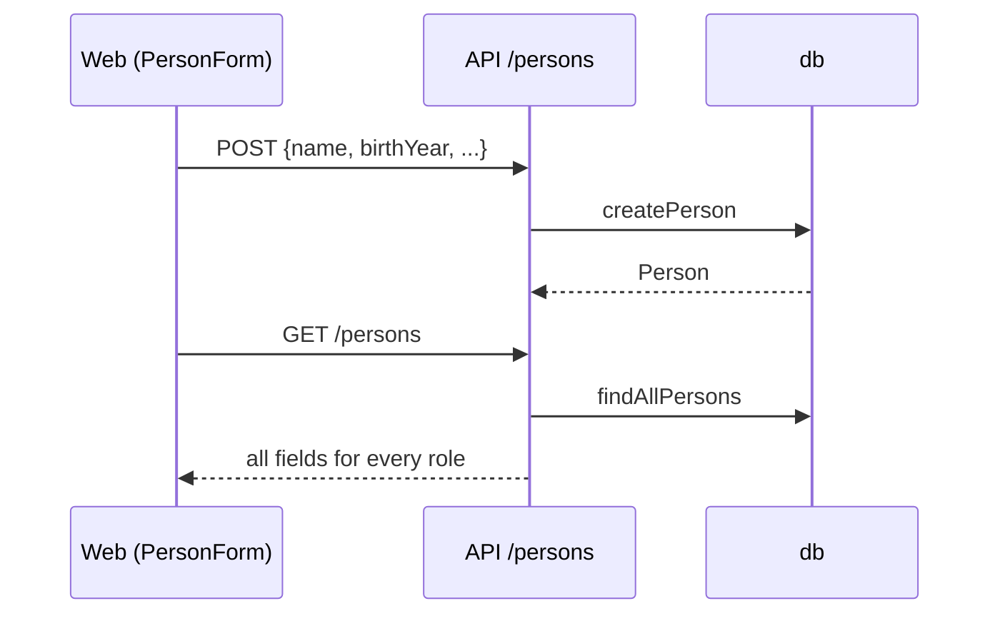
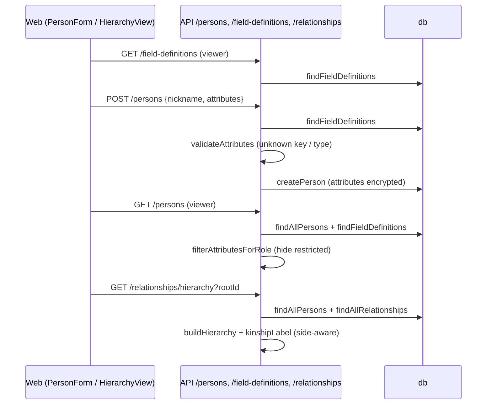

## Why

Ordinary users forget the names, nicknames, and basic facts (current work, study, location) of people they know: relatives, friends, juniors, teachers. Atlas Lineage places people on a map by birth coordinates, which does not help with that. This change makes a person-centred family memory the primary model, with the map kept as one view.

Validated assumptions and kill criterion are in the conviction brief: users add or update at least one record per month; the idea is wrong if most active users stop updating after three months.

## What Changes

- **Nickname-first people.** `nickname` is the only required field. `name` (full name) and `birthYear` become optional. Existing records keep their names.
- **Tree-defined fields.** New `field_definitions` table. Group owners add, relabel, and delete fields without a migration. Each field has a key, label, category, value type (`text|number|date|longtext`) and visibility (`members|restricted`).
- **Attributes as one encrypted JSON blob** per person (`persons.attributes`), validated against the tree's definitions on write. Unknown keys are rejected.
- **Visibility.** `restricted` attribute values are removed from responses for viewers. Owners and editors see them.
- **Relationship side.** `relationships.side` (`paternal|maternal`) records which family line a parent or child belongs to. It decides grandparent labels (ปู่/ย่ vs ตา/ยาย).
- **Hierarchy view.** `GET /api/relationships/hierarchy?treeId&rootId` builds a kinship list centred on any person (up to two hops) with Thai kinship labels. A new "ลำดับชั้น" view in the web app uses it.
- **Map retained** as an existing view. Its data is unchanged.

Out of scope for this change: friend and school groups as timelines, memory and story attachments, data migration of existing production data, and enforcing `tree_members` roles (issue #9). Field-level admin is restricted to the tree owner, not to a separate admin role.

## Impact

- DB: migration `0008_family_memory_fields` is additive only (two nullable columns, one nullable column, one new table with an enum pair).
- API: `PersonsService.findAll/findOne` take the caller's role. `CreatePersonDto` no longer requires `name` or `birthYear`. The guard records `req.treeRole`.
- Existing tests that required `name`/`birthYear` were updated to the nickname-first contract.

## Flow (service and data path)

Before:

After:

